# CTViewer · 34 款真实跑车 / 赛车 3D 拆解可视化查看器

基于 **Three.js r169 + WebGL 2** 的纯前端 3D 车型拆解查看器。内置 **34 款**来自 GitHub / Sketchfab 的真实跑车、超跑、赛车与概念车 GLB 模型，支持逐零件爆炸、悬停高亮、12 种车漆工艺、语义化零件命名、车型库与视角预设；另带 **10 位少女前线 2 人物**与 **15 段动作**，可以下车库在城市里第三人称自由探索。**2.19 起车库变成可玩场景**：两柱举升机与底盘视角、可驾驶的街机试驾（含引擎声与速度表）、拍照 / 录像模式；人物在车旁按 `E` 上车。全部 Three.js 运行时、Draco 解码器和模型均已本地打包，断网可完整运行。

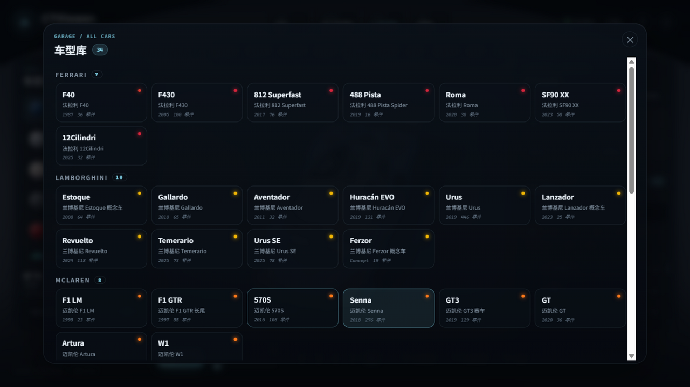

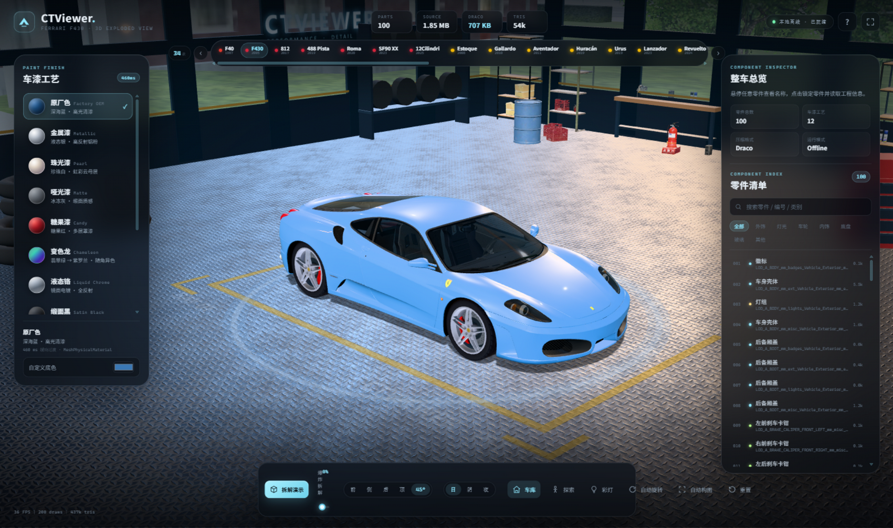

车库地面铺了一层真实的花纹钢板（ambientCG CC0），右侧与后侧是带铝合金立柱的玻璃幕墙，**正面与左侧完全敞开**——人物可以直接从广场走进车库；天花板彩灯可开关：

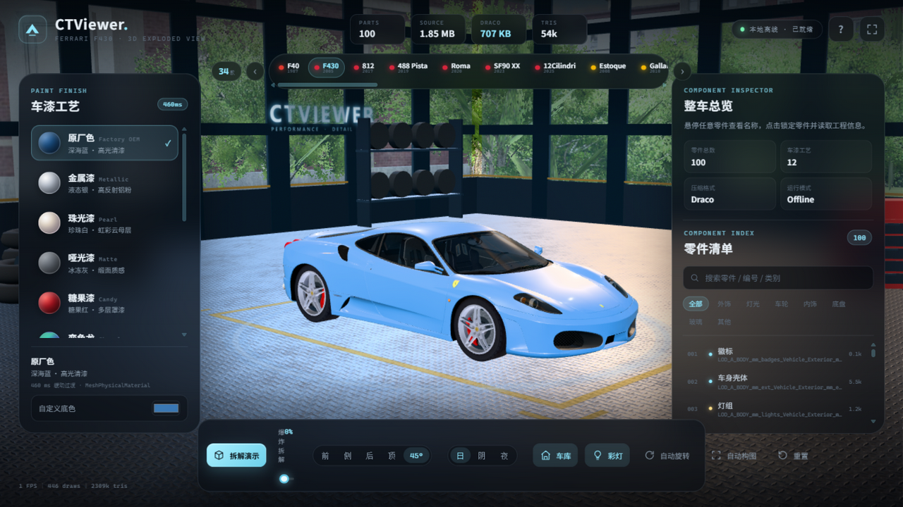

后墙一线是完整的维修工位：钢架货架、旧金属架、木工台（台虎钳 / 油壶 / 喷漆罐）、工具柜、台钻、发电机、工具推车、轮胎与轮毂、油桶、周转箱、灭火器……21 件车间道具来自 Poly Haven（CC0），按真实尺寸落地并带行走碰撞：

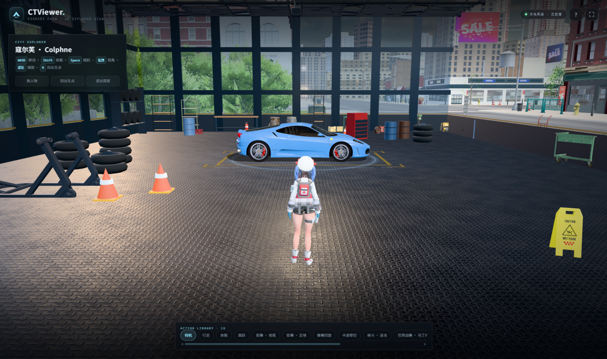

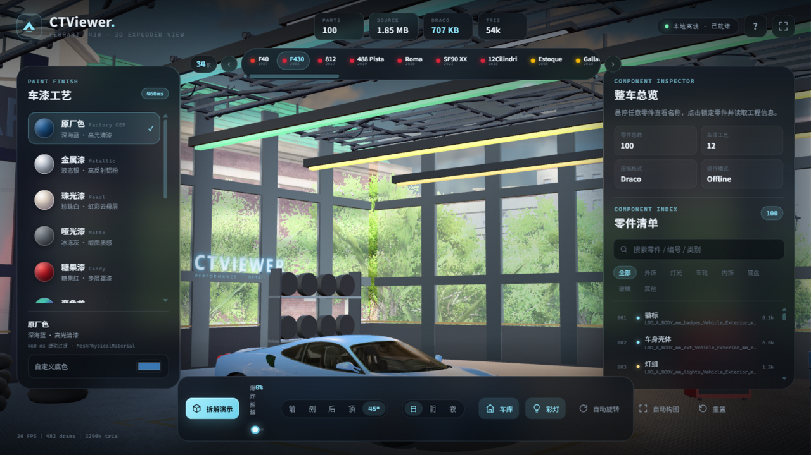

车库外是 Unity《天天赛车》的城市街区，日 / 阴 / 夜 三档天光一键切换：

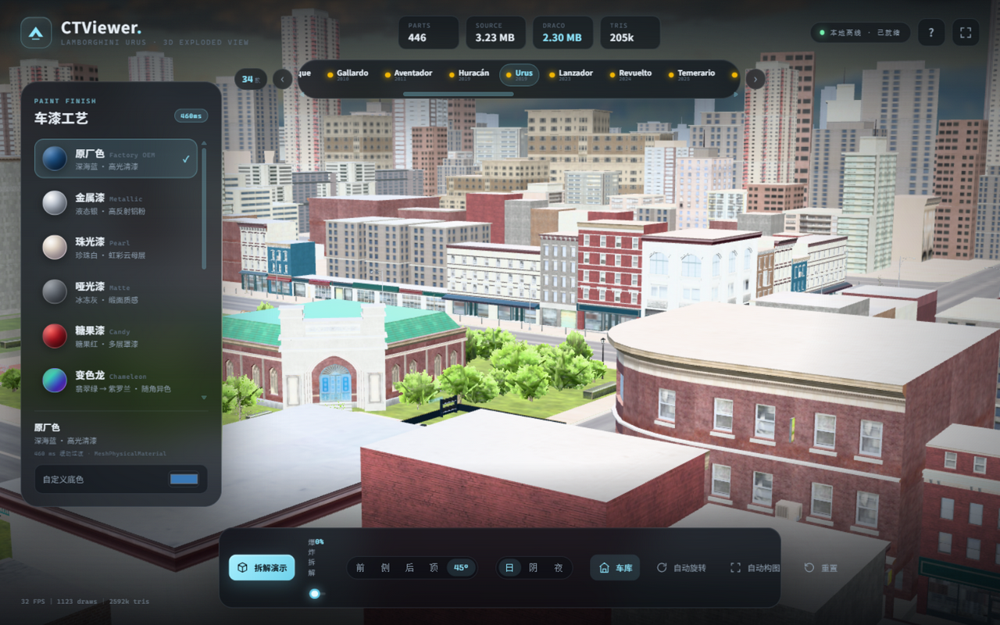

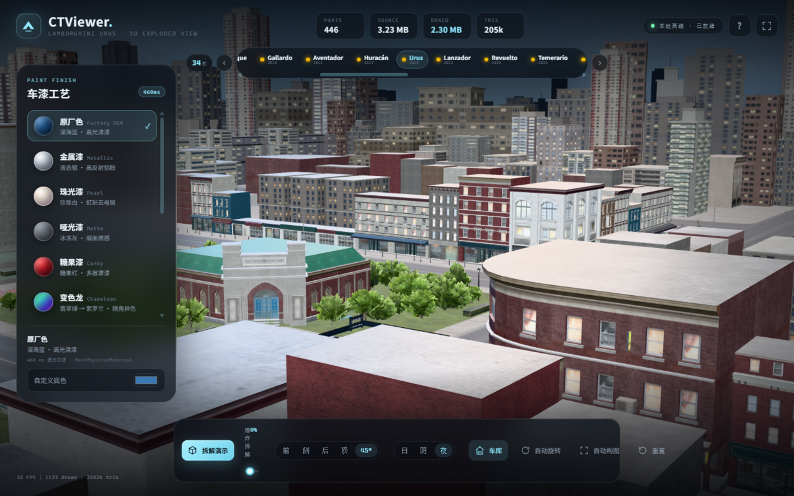

底部「探索」可以挑一位干员下车库，人物带 15 段动作，从城市广场的出生点出发自由行走：

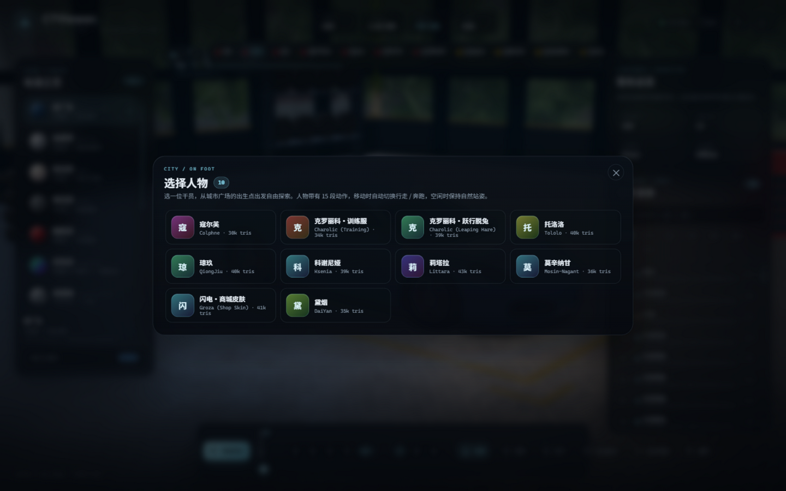

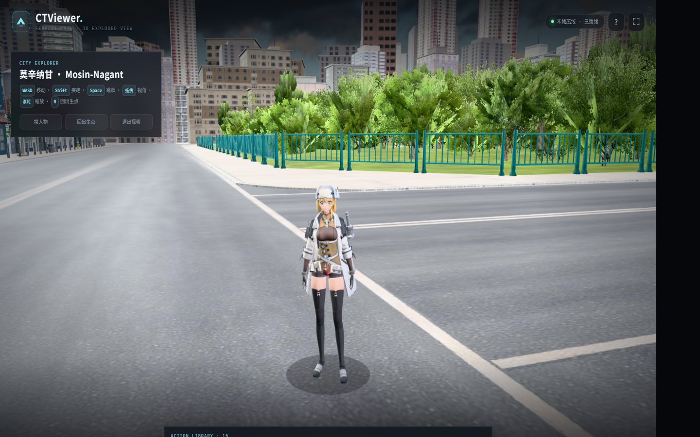

2.19 起车库不只是展柜：两柱举升机能把车顶起来看底盘，车可以原地起步开出去试驾，还有拍照 / 录像模式；人物探索只保留「走到车旁上车」这一种互动：

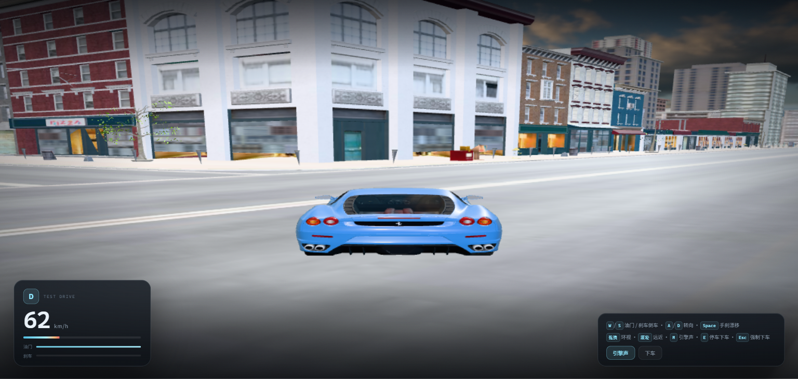

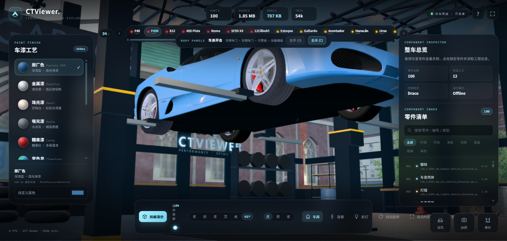

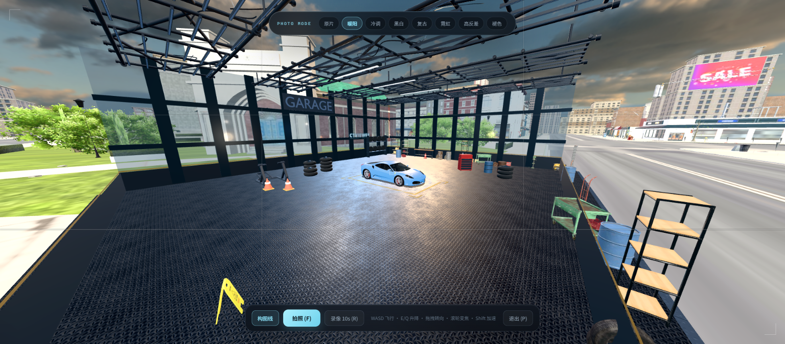

## 一、车型库（34 款 · 3,241 个零件 · 615 万三角面）

| 车型 | 零件数 | 三角面 | 源文件 | Draco 压缩 | 许可 |
| --- | ---: | ---: | ---: | ---: | --- |
| Ferrari 12Cilindri (2025) | 32 | 244,838 | 2.77 MB | 1.62 MB | CC BY 4.0 · Ddiaz Design |
| Ferrari 488 Pista Spider (2019) | 16 | 86,513 | 1.80 MB | 0.73 MB | CC BY 4.0 · Ddiaz Design |
| Ferrari 812 Superfast (2017) | 76 | 52,757 | 1.73 MB | 0.66 MB | CC BY 4.0 · Galaxy Car Showroom |
| Ferrari F40 (1987) | 36 | 206,980 | 0.93 MB | 0.66 MB | CC BY 4.0 · Black Snow |
| Ferrari F430 (2005) | 100 | 53,913 | 1.85 MB | 0.69 MB | CC BY 4.0 · Ddiaz Design |
| Ferrari Roma (2020) | 30 | 191,156 | 2.56 MB | 1.15 MB | CC BY 4.0 · Ddiaz Design |
| Ferrari SF90 XX Stradale (2023) | 58 | 146,098 | 2.45 MB | 1.21 MB | CC BY 4.0 · Ddiaz Design |
| Lamborghini Aventador (2011) | 32 | 360,992 | 7.08 MB | 2.82 MB | CC BY 4.0 · BlackCube |
| Lamborghini Estoque Concept (2008) | 64 | 16,649 | 2.09 MB | 0.35 MB | CC BY 4.0 · Ddiaz Design |
| Lamborghini Ferzor Concept (Concept) | 19 | 55,996 | 1.23 MB | 0.35 MB | CC BY 4.0 · SINNIK |
| Lamborghini Gallardo (2010) | 65 | 69,993 | 9.79 MB | 2.46 MB | CC BY 4.0 · Artem P |
| Lamborghini Huracán EVO (2019) | 131 | 76,831 | 3.98 MB | 0.96 MB | CC BY 4.0 · Galaxy Car Showroom |
| Lamborghini Lanzador Concept (2023) | 25 | 181,221 | 6.61 MB | 1.31 MB | CC BY 4.0 · Ddiaz Design |
| Lamborghini Revuelto (2024) | 118 | 189,889 | 4.13 MB | 1.64 MB | CC BY 4.0 · Ddiaz Design |
| Lamborghini Temerario (2025) | 73 | 196,598 | 7.63 MB | 2.67 MB | CC BY 4.0 · Harsh Palan |
| Lamborghini Urus (2019) | 446 | 205,140 | 3.23 MB | 2.30 MB | CC BY 4.0 · Ddiaz Design |
| Lamborghini Urus SE (2025) | 78 | 208,957 | 2.54 MB | 1.25 MB | CC BY 4.0 · Ddiaz Design |
| McLaren 570S Coupe (2016) | 108 | 55,264 | 1.45 MB | 0.55 MB | CC BY 4.0 · Ddiaz Design |
| McLaren Artura (2023) | 44 | 186,261 | 3.07 MB | 1.30 MB | CC BY 4.0 · Ddiaz Design |
| McLaren F1 GTR Longtail (1997) | 55 | 108,817 | 15.29 MB | 1.28 MB | ⚠ 未声明 · GitHub |
| McLaren F1 LM (1995) | 23 | 11,973 | 11.64 MB | 0.55 MB | CC BY 4.0 · Ajay Gawde |
| McLaren GT (2020) | 36 | 79,877 | 1.45 MB | 0.82 MB | CC BY 4.0 · Ddiaz Design |
| McLaren GT3 (2019) | 129 | 206,941 | 33.88 MB | 3.92 MB | ⚠ 未声明 · GitHub |
| McLaren Senna (2018) | 276 | 358,427 | 25.74 MB | 1.43 MB | ⚠ 未声明 · GitHub |
| McLaren W1 (2024) | 130 | 438,058 | 45.20 MB | 4.98 MB | ⚠ 未声明 · GitHub |
| BMW M3 G80 (2025) | 144 | 310,242 | 10.30 MB | 3.14 MB | CC BY 4.0 · Drifter Models |
| BMW M4 Competition (2021) | 39 | 162,893 | 2.44 MB | 1.14 MB | CC BY 4.0 · RES1N |
| BMW M4 Widebody (2021) | 61 | 340,222 | 21.48 MB | 1.81 MB | ⚠ 未声明 · GitHub |
| BMW M5 F90 (2018) | 100 | 181,511 | 7.79 MB | 1.99 MB | CC BY 4.0 · RES1N |
| Porsche 911 Carrera 4S (2020) | 74 | 73,713 | 13.21 MB | 1.86 MB | CC BY-SA 4.0 · Lionsharp Studios |
| Ford Mustang GT3 (2024) | 103 | 238,786 | 91.05 MB | 2.50 MB | ⚠ 未声明 · GitHub |
| Nissan GT-R R35 (2017) | 245 | 255,138 | 14.22 MB | 1.63 MB | ⚠ 未声明 · GitHub |
| Xiaomi SU7 Ultra (2025) | 146 | 515,312 | 30.83 MB | 2.47 MB | ⚠ 未声明 · GitHub |
| Yangwang U9 (2024) | 129 | 84,435 | 5.03 MB | 0.68 MB | ⚠ 未声明 · GitHub |
| **合计（34 款）** | **3,241** | **6,152,391** | **396.5 MB** | **54.89 MB** | — |

另有 34 个 `.lod.glb` 渐进式预览，合计 35.68 MB。模型来源、作者与许可见 [CREDITS.md](CREDITS.md)。

> **Lamborghini Lanzador** 的 `advanced/` 零件集缺少车身主体，已改回 `basic/` 完整模型，并在构建期用 `join` 把 2703 个碎片合并成 25 个零件。
> **Lamborghini Ferzor** 的导出绕车身纵轴躺倒 90°，由 `models.json` 的 `rotate: [-90, 0, 0]` 在归一化前修正。
> **BMW M2 (G87)** 源文件本身被压扁（3.67×0.70×2.27）且带游离碎片，无法在不猜测比例的前提下修复，已从车型库删除。

> ⚠️ **许可提示**：**9 款**（McLaren GT3 / F1 GTR / W1 / Senna、BMW M4 Widebody、Ford Mustang GT3、Nissan GT-R R35、Xiaomi SU7 Ultra、Yangwang U9）来自第三方 GitHub 仓库，**这些仓库未声明任何许可**，只在个人本地学习 / 研究范围内使用，不得对外分发。其余 **25 款**为 CC BY 4.0 / CC BY-SA 4.0。

## 二、功能对照

| 需求 | 实现 |
| --- | --- |
| 真实赛车/跑车模型，多款式 | 34 款真实车型，顶部横向车型条 + **车型库面板（按品牌分组，L 键）** 双入口，按需懒加载 |
| 零件拆分 / 爆炸视图 | 从 GLB 场景图逐网格提取零件（最多 446 个）；0–100% 径向爆炸 + 自动构图，保留车轮、车门、玻璃、灯组等独立零件 |
| 零件命名 | `js/parts.js` 优先查 `SEMANTIC` 表（预拆分零件模型用），否则按名称 / 材质 / 位置启发式推断 |
| 模型摆正 | `models.json` 的 `rotate` 修正侧翻模型（Lamborghini Ferzor 导出时绕 X 轴躺倒 90°），`join` 合并碎片化模型（Lanzador 2703 → 25 件） |
| 坏模型剔除 | BMW M2 (G87) 源文件本身被压扁（3.67×0.70×2.27）且带游离碎片，无法修复，已从车型库移除 |
| 悬停零件高亮 | Raycaster 拾取 + 菲涅尔边缘高亮壳层（Fresnel Shader） |
| 三方联动 | 3D 点选同步零件清单与检视卡，清单悬停反向高亮；空白处点击取消选择 |
| 12 种车漆工艺 | 原厂色 / 金属漆 / 珠光漆 / 哑光漆 / 糖果漆 / 变色龙 / 液态铬 / 缎面黑 / 拉丝钛 / 熔岩橙 / 霓虹紫 / 英伦绿，另加自定义底色；烘焙贴图车型自动禁用并给出说明 |
| 车库场景 | 内置 3D 维修车库（`assets/scenes/garage.glb`，641 KB Draco）：按模型自带地坪把地面标定到 y=0，**再在其上铺一层 60 mm 花纹钢板**（ambientCG `DiamondPlate008D` 的漫反射 / 法线 / 粗糙度 / 金属度四张图，1.7 m 一铺，带深色包边），车、陈设、工位标线随之上移 60 mm，轮胎压在钢板上；四周护墙板与安全黄线，轮胎堆 / 轮胎架 / 工具柜 / 锥筒 / 油桶 / 顶部灯带 / `CTVIEWER` 霓虹墙招，13–44 m 体积雾；**只保留 −X 与 −Z 两面玻璃幕墙，+X 与 +Z 完全镂空**（人物从广场直接走进车库）；后墙一线补了 21 件 Poly Haven CC0 车间道具（货架 / 工作台 / 台钻 / 发电机 / 工具推车 / 梯子 / 轮胎轮毂 / 油桶 / 周转箱 / 灭火器 / 小心地滑牌），按包围盒底部中心落地，3.9 MB Draco GLB（2.17 减面到 40 %）；一键切换「车库 / 无缝影棚」 |
| 玻璃幕墙 | 模型自带的发光墙板换成**带窗框的玻璃幕墙**：44% 不透明的冷调玻璃（清漆 + 环境反射，城市天际线仍全幅可见），并从几何体里自动量出窗格间隙，在每个缝里补上铝合金立柱与横梁（`_frameGarageGlass`），墙面不再像悬空的玻璃片 |
| 天花板彩灯 | 六根霓虹灯管 + 三盏彩色聚光灯，色相沿天花板缓慢流转（灯管彼此错开 0.15 个色相环，实打实的炫彩）；环境反射切换到 Poly Haven 实拍霓虹工作室 HDRI（CC0），中性灯与室外日照同步压到 38% / 35%，把房间交给颜色；底部「彩灯」按钮开关，`?lights=1` 可深链 |
| 人物与动作 | 10 位少女前线 2 角色（10 个 GLB，合计 6.2 MB）共用 15 段 Mixamo 动作（`assets/characters/animations.glb`，1.6 MB）：待机 / 行走 / 奔跑 / 跳跃 / 街舞两段 / 蝶舞 / 卡波耶拉 / 连击 / 马丁内罗 / 回旋踢 / 受击 / 剑术 / 起身 / 火炬近战。逐骨**只搬摆动量**重定向：把目标骨骼的静止方向转到动作要求的方向，目标保留自己的绑定卷曲，所以 T-pose 与 A-pose 的差异不会叠加成折臂、也不会把四肢拧成麻花；髋部位移按各人物身高重设、并按 0.1 s 采样烘焙了逐人物逐动作的地面贴合表（`assets/characters/ground.json`，躺姿 / 跪姿不再穿地、跳起仍能离地），Idle 是常驻自然站姿，走路 / 奔跑按速度自动交叉淡入 |
| 城市第三人称探索 | 底部「探索」选择角色后从广场出生点（地面光环 + 光柱 + `出生点 · SPAWN` 标牌）出发，`WASD` 相机相对移动、`Shift` 疾跑（8.8 m/s，步行 1.75 m/s）、`Space` 跳跃（离地约 0.95 m）、拖拽环绕、滚轮缩放、`R` 回出生点、`Esc` 退出；动作面板可随时播放任意一段动作，结束后自动回到待机。碰撞来自城市几何烘焙出的 1 m 占位网格（建筑 / 树木）、车库的 −X / −Z 两面玻璃墙、21 件道具的占地盒与整车包围盒（人物可以正面 / 左侧自由进出，但不会穿墙、穿货架或穿过车）。物理按 1/120 s 固定子步积分，低帧率下跑速与跳跃高度不会缩水 |
| 试驾模式（2.19） | 底部「试驾」或车旁按 `E` 上车：人物隐藏、相机切追尾视角，车辆用 1/120 s 子步的街机物理（前向 / 侧向速度分解 + 运动学自行车转向）行驶，`W/S` 油门与刹车倒车、`A/D` 转向、`Space` 手刹漂移、`M` 开关程序合成的引擎声；碰撞复用城市 1 m 占位网格、车库两面实墙、道具占地盒与举升机立柱，车头 / 车尾 / 四角共 8 个采样点，撞墙后沿墙滑动而不是穿模。**进入试驾后车停在展位原位、原地转向车库开口，只有玩家给油才会移动**；`E` 停车下车（`Esc` 强制），下车后人物出现在驾驶侧门边，车辆回到展位 |
| 两柱举升机（2.19） | 车库中央展位下内置程序化两柱举升机（立柱 + 横梁 + 四条可摆臂 + 安全黄），**降下时整体隐藏**，不挡车身视角也不参与碰撞；`G` 或底部「举升」升起 1.5 m（0.85 m/s），车辆与爆炸零件一起上升；视角预设新增「底」：自动升起举升机并把相机压到地面仰视底盘。试驾时把车停回中央黄色标线按 `G` 也能举升，举升期间锁定油门 |
| 拍照 / 录像（2.18） | `P` 进入：隐藏全部界面，自由飞行相机（`WASD` + `E/Q` 升降 + 拖拽转向 + 滚轮变焦 + `Shift` 加速），8 种滤镜（原片 / 暖阳 / 冷调 / 黑白 / 复古 / 霓虹 / 高反差 / 褪色）实时作用于画布，九宫格构图线可开关；`F` 导出当前画质的 PNG，`R` 录 10 s WebM（最高 1080p，2D 画布带滤镜实时转码），文件名自动带车型与时间戳 |
| 上车 / 下车（2.19） | 探索时走到车旁出现「按 E 上车」提示，按 `E` 或 HUD 的「开车」直接进入试驾；下车后人物出现在驾驶侧门边。靠车 / 坐引擎盖 / 抱胸三种摆拍姿势已移除，人物探索只保留行走、奔跑、跳跃、动作库与开车 |
| 远距视角墙体 | 两处方向都错过：①天花板裁剪平面原来法线写反（`(0,-1,0)` + 负距离），把「裁掉屋顶以上」变成了「裁掉屋顶以下」，视角一到屋顶之上整面玻璃幕墙就消失；②屋顶的隐藏条件只看相机高度，轨道拉远把眼睛抬到 5.81 m 以上时（相机其实还在车库外 30 m 处）屋顶也被藏掉，看起来像露天盒子。现在裁剪平面用 `(0,1,0)` + 天花板高度，隐藏条件加「相机水平位置必须落在车库平面内」并带 1 m / 3 m 迟滞。实测 45 m 远视角（相机 y=10.04）屋顶 11 块网格全部可见，顶视图（y=11.22，正上方）仍只裁屋顶 |
| 城市环境 | 车库嵌在 Unity《天天赛车》的 Classical_city 街区正中：烘焙为单个 GLB（10 个按材质合并的网格 / 19.2 万三角面 / meshopt + KHR_mesh_quantization），中心街区 620 m 见方，外围 5 份 1.65× 远景环补齐天际线；2.17 把贴图从 10 张 2048² 降到 512²（9.0 MB → 1.1 MB），文件 13.8 MB → **4.5 MB** |
| 性能与加载（2.17） | 45° 主视角 **534 draw call / 271 万三角面 / 17–22 FPS** → **200 draw call / 43.7 万三角面 / 45–52 FPS**（1701×1007，Iris Xe 集显）：①远景环在相机距中心 < 110 m 时整体隐藏（−5×33.7 万面）；②城市块 simplify 到 19.2 万面、贴图 512²（省 1.7 万面 + 8 MB 下载 + 约 200 MB 显存）；③车模与 21 件道具里所有 `transmission` 材质改普通透明，去掉 three 的第二遍全场景透射通道（单帧渲染 14.7 → 1.3 ms）；④道具 simplify 到 40 %（48.4 万 → 20.6 万面）+ 按材质合批（150 → 91 个网格），窗框 20 → 1；⑤动态分辨率控制器按实测帧率在 0.55–1.0 之间调渲染比例，稳住 45–52 FPS；`?q=low|medium|high` 画质档、`?dpr=` 可锁死渲染比例 |
| 天光时段 | 日 / 阴 / 夜 三档，各用项目自带的实拍 HDRI（`day_sky` / `overcast_sky` / `night_sky`），经 PMREM 同时作背景与 IBL；夜晚由 Unity 的 `*_light` 窗光贴图驱动城市自发光，底图同步压暗 |
| 460ms 缓动过渡 | `paintTransitionMs: 460`，easeInOutCubic 逐项插值 |
| 视角预设 | 前 / 侧 / 后 / 顶 / 底 / 45°，按包围盒在视线方向的投影精确构图（不再用包围球），前后视角留在墙内、顶部视角隐藏屋顶并裁剪墙体；「底」自动升起两柱举升机并从地面仰视底盘；`?view=side` 可深链 |
| 键盘操作 | `1–0` 车漆（`-`/`=` 第 11/12 种）、`E` 拆解、`R` 重置、`F` 构图、`A` 旋转、`L` 车型库、`←/→` 换车、`↑/↓` 逐个零件检视、`Esc` 取消；`V` 试驾、`P` 拍照 / 录像、`G` 举升机、`O` 车身全开、`C` 全关；探索模式改为 `WASD` 移动、`Shift` 疾跑、`Space` 跳跃、`R` 回出生点、`Esc` 退出、车旁 `E` 上车；试驾模式 `W/S` 油门刹车、`A/D` 转向、`Space` 手刹、`M` 引擎声、`G` 举升、`E` 下车 |
| Draco 压缩 | 每款车型独立 `KHR_draco_mesh_compression`，本地 WASM/JS 双解码器 |
| 纹理压缩 | 构建期 WebP 1024（`scripts/compress_textures.mjs`），源 115 MB → 压缩 36.5 MB |
| 渐进式加载 | 每款车先加载 `.lod.glb` 轻量预览，再流式加载完整 Draco 模型 |
| 离线运行 | `vendor/` 全量本地 + Service Worker / Cache Storage 缓存 |
| 自动构图 | 动态计算全部可见零件包围盒，按 FOV 与宽高比自动求距离 |
| 无外部 CDN 依赖 | 默认 `cdnBase: ''`，`index.html` 无任何外链；可选 `?cdn=1` 启用 jsDelivr 镜像 |

## 三、快速运行

```bash
cd ctviewer
python3 -m http.server 8030 --bind 0.0.0.0
# 浏览器打开 http://127.0.0.1:8030
```

或 `npm run serve` / `start.bat` / `start.sh`。

> 浏览器安全策略禁止 `file://` 下 `fetch()` 读取 GLB，请使用本地静态服务器。
> 升级后如果浏览器仍显示旧版本，请打开 `http://127.0.0.1:8030/?v=2.19.1` 或按 `Ctrl+F5`；页面内置一次性 Service Worker / Cache Storage 清理。

### URL 深链 / 演示参数

| 参数 | 说明 |
| --- | --- |
| `?car=mclaren-f1lm` | 启动时选择车型（34 款车型 ID 见 `assets/models/catalog.json`） |
| `?paint=candy` | 启动时选择车漆（`factory / metallic / pearl / matte / candy`） |
| `?explode=1` | 启动后自动播放拆解（模型就绪后应用，慢设备也可靠） |
| `?part=P002` | 启动后选中指定零件 |
| `?view=front` | 启动视角（`front / side / rear / top / under / hero`） |
| `?scene=studio` | 启动场景（默认 `garage`，`studio` 为无缝影棚） |
| `?lights=1` | 启动即打开天花板彩灯（等同点底部「彩灯」） |
| `?explore=colphne` | 启动后直接以指定人物进入城市探索（人物 ID 见 `assets/characters/characters.json`） |
| `?drive=1` | 启动后直接进入试驾（车辆停在展位原位） |
| `?lift=1` | 启动后自动升起两柱举升机 |
| `?drive=1` | 启动后直接进入试驾模式 |
| `?photo=1` | 启动后直接进入拍照模式 |
| `?sky=night` | 启动天光（`day / dusk / night`，默认 `day`） |
| `?cdn=1` | 启用 `js/config.js` 中配置的 jsDelivr 镜像 |
| `?lite=1` | 低配 / 软件渲染诊断模式（等同 `?q=low`） |
| `?q=low\|medium\|high` | 画质档位（默认 `high`；`low` 关阴影、基准 DPR 1） |
| `?dpr=0.75` | 固定渲染比例并关闭动态分辨率（截图 / 录屏时锁画质） |
| `?lodOnly=1` | 仅加载 LOD 预览 |
| `?nosw=1` | 禁用并注销 Service Worker |

## 四、本地开发

- 本项目按**本地开发**定位：浏览器直接打开 `http://127.0.0.1:8030` 即可，不需要构建、不需要安装。
- 不发布、不提供安装包。旧的 Android WebView APK 与 `d8.jar` 已于 2.17 删除，
  `android/` 只保留壳工程源码作参考；`tests/test_static.py` 会拦住 APK 重新混入仓库。

## 五、目录结构

```
ctviewer/
├── index.html                  # 页面结构、importmap、车型条、车型库、视角预设
├── css/style.css               # 深色摄影棚 UI、响应式布局
├── js/
│   ├── config.js               # 运行时配置、12 种车漆 preset
│   ├── catalog.js              # 34 款车型目录（自动生成）
│   ├── parts.js                # 语义零件表 + 启发式命名 + 分类
│   ├── paint.js                # MeshPhysicalMaterial 车漆 + 460ms 过渡
│   ├── viewer.js               # 场景、多车型加载、拾取、爆炸、视角预设、自动构图
│   ├── sky.js                  # 三档天光 HDRI → 背景 + PMREM 环境
│   ├── city.js                 # 城市 GLB 加载、居中布局、远景环、夜景自发光、1 m 碰撞网格
│   ├── characters.js           # 10 位人物、15 段动作、出生点、第三人称探索与上车
│   ├── character-clips.js      # 髋部重定向 + 地面贴合表应用（运行时与烘焙页共用）
│   ├── drive.js                # 街机试驾：物理、追尾相机、碰撞、引擎声、遥测
│   ├── photo.js                # 拍照 / 录像：自由相机、滤镜、构图线、PNG / WebM
│   └── main.js                 # UI 绑定、车型库、零件清单、快捷键、深链
├── assets/models/
│   ├── catalog.json            # 车型统计与许可（自动生成）
│   ├── <car>.glb               # 34 款 Draco + WebP 模型
│   └── <car>.lod.glb           # 34 款渐进式预览
├── assets/characters/
│   ├── characters.json         # 10 位人物 + 15 段动作目录
│   ├── animations.glb          # 共享动作库（骨骼旋转 + 髋部位移）
│   ├── ground.json             # 逐人物逐动作的地面贴合表（19 KB）
│   └── <id>.glb                # 10 个 Draco + WebP 蒙皮人物
├── assets/scenes/garage.glb    # 3D 车库背景（Draco + WebP，641 KB）
├── assets/props/               # 21 件车间道具（Poly Haven CC0，Draco，3.9 MB）
├── assets/scenes/city/city.glb # 城市街区（simplify + 512 贴图 + meshopt，4.5 MB）
├── assets/scenes/*.hdr         # 日 / 阴 / 夜 三张实拍全景（12.6 MB）
├── vendor/                     # Three.js r169 + Draco 本地资源
├── scripts/
│   ├── models.json             # 车型元数据 / 许可 / 源地址 / 预拆分零件清单
│   ├── fetch_models.py         # 下载 CC 许可源模型（含 advanced 零件集）
│   ├── merge_parts.mjs         # 合并预拆分零件并保留语义节点名
│   ├── compress_textures.mjs   # WebP 1024 纹理压缩（sharp sRGB 修正）
│   ├── build_models.py         # LOD、车漆材质识别、生成 catalog.js / CREDITS
│   ├── city_textures.mjs       # Unity TIF → Web（绿化保 alpha，去预乘压黑）
│   ├── city_glb.mjs            # 城市 GLB：weld / quantize / meshopt / 贴图重编码
│   └── build.sh                # 一键模型管线（4 步）
├── build/
│   ├── build_props.sh          # 21 件车库道具：下载 → 512 px → Draco GLB
│   ├── prop_urls.py            # 只读 Poly Haven 清单并打印文件 URL（域名白名单）
│   ├── build_anim_swing.py     # 15 段动作摆重重定向 → animations.glb
│   └── verify_retarget.py      # 逐骨方向自检
├── tools/                      # 构建期工具页：FBX→GLB 烘焙、城市布局预览、车型朝向自检
├── assets/scenes/garage/       # 花纹钢板 PBR 四图（ambientCG CC0）+ 霓虹 HDRI
├── models_src/_unity_city/     # 城市构建源（FBX + TIF + 中间贴图），不参与部署
├── sw.js                       # Service Worker 离线缓存
├── android/                    # Android WebView 壳工程（APK / d8.jar 已移除）
├── tests/                      # 静态验收 400 项 + Playwright 冒烟测试
└── docs/                       # 验收报告、实施计划、车型库截图
```

## 六、构建模型

```bash
npm install                 # 安装 gltf-transform CLI 与 playwright
bash scripts/build.sh       # 下载 → 合并零件 → 纹理/几何优化 → LOD + 目录
```

四个阶段：

1. `fetch_models.py` 从 `supercar3d/supercar_3D_asssets` 下载源 GLB；`advanced/` 的预拆分零件按 `models.json` 的 `parts` 列表逐个落盘到 `models_src/_parts/<id>/`。
2. `merge_parts.mjs` 把每个零件文件里的网格节点重命名为文件名（`door_lf`、`wheels_rf`…），再交给 `gltf-transform merge --merge-scenes true` 合成单场景——零件位置由原文件自带的节点变换保留。
3. `compress_textures.mjs` 以 sharp 把纹理转 WebP 1024（显式 `.toColourspace('srgb')`，绕开 Windows 上 libvips 的 `colourspace: parameter space not set`），随后 CLI `optimize` 做去重 / weld / draco。
4. `build_models.py` 生成 4% LOD、自动识别车漆材质、写出 `catalog.json` / `catalog.js` / `CREDITS.md`。

4. `build/verify_retarget.py` 逐骨比对重定向结果与源动作的朝向，出问题先跑它（它只比方向，卷曲要看渲染）。
5. `tools/ground_bake.html` 在浏览器里按运行时同一套算法（髋部重定向 + 逐帧蒙皮包围盒）采样每个人物每段动作的最低点，写出 `assets/characters/ground.json`（19 KB，10 人物 × 15 动作），运行时 `applyGroundLift()` 直接查表。采样时排除头发 / 毛领 / 流苏（长马尾躺下会铺到地面以下，抬身体反而让人悬空）。

构建产物直接提交到 `assets/models/`，查看器本身零构建即可运行。

### 车库道具管线（Poly Haven CC0）

```bash
bash build/build_props.sh
```

1. `build/prop_urls.py` 只读 Poly Haven 的文件清单：域名锁定 `api.polyhaven.com` /
   `dl.polyhaven.org`，拒绝重定向、拒绝私网 / 环回地址（本机 fake-IP 代理段 198.18.0.0/15
   单独放行），并用正则约束资源名与相对路径，只把 URL 打到 stdout，不落盘。
2. shell 侧再校验 URL 前缀与相对路径，`curl` 到 `build/_dl/polyhaven/<name>/`（1K glTF 源包）。
3. Node + sharp 把三张贴图降到 512 px 再写回——直接让 gltf-transform 的 textureCompress
   处理这批 JPEG 会触发 libvips 的 `colourspace: parameter space not set`。
4. `gltf-transform copy` + `gltf-transform draco` 打包成 `assets/props/<name>.glb`
   （21 件，合计 3.9 MB，单件 76–360 KB；2.17 再减面到 40 %）。

### 人物与动作管线（开发期，需要 Blender 4.2）

1. `build/extract_anims.py` 在 Blender 里逐个导入 15 段 Mixamo FBX，导出每根骨骼的**绝对世界朝向**（`d × rest`，同时记下 Mixamo 骨架自身的静止世界朝向）与髋部世界位移到 `build/anims_v2.json`。第一版只存相对增量，A-pose 的游戏骨架与 T-pose 的 Mixamo 一叠加就把手臂折到背后，因此改成绝对姿态。
2. `build/build_characters.py` 逐个人物导入 FBX，修掉 FBX 指向不存在贴图的材质（EyeShadow 指向的是 `Textures` 目录）与导入器带来的 Alpha=0，纹理压到 1024，再导出 Draco + WebP 的蒙皮 GLB（10 个，合计 6.2 MB）。
3. `build/build_anim_swing.py` 直接写 glTF：对每根骨骼求「目标静止方向 → 动作方向」的最短弧，乘回目标自身的静止旋转，再逐级解算成节点局部旋转，生成共享的 `animations.glb`（15 段，1.6 MB）。只搬摆动、保留目标卷曲，手臂下垂时额外外展 8° 离开髋部，髋部竖直以骨架静止髋高为零点。绕开 Blender 的 glTF 导出器，是因为它把这套骨架 7° 的髋部旋转写成了 176°，整套动作都会把人物折断。

## 七、技术要点

### 1. 多车型统一坐标

不同 Sketchfab 模型的单位、朝向、根节点变换差异很大。加载时在 `_flattenAndNormalize()` 中：

- 把每个节点的 `matrixWorld` 烘焙进几何体；
- 按最长水平轴统一旋转为车头朝 +X；源资产里有 3 台车头原本指向 −X（`models.json` 的 `flip`），先在自身坐标系里绕 Y 轴转 180°，再套用 `rotate` 的侧翻修正；
- 统一缩放到 4.55 m 车长，中心归零、轮胎落在 y=0；
- 之后所有零件拾取、爆炸方向、视角预设和相机拟合都使用同一套世界坐标。

朝向为什么要较真：前视相机就站在 +X，零件命名也把 +X 一侧叫「前」（前轮胎 / 前保险杠 / 前部覆盖件）。
车头反过来时，前视图拍到的是车尾，前后轮的标签也跟着反。审查页 `tools/car_orient.html`
用与运行时同一套归一化把 34 台车渲染成侧视总表，并打印「座舱重心」指标（座舱相对车身中心的 X 偏移，
正确朝向应恒为负值）；`?mode=faces` 出正面对照表、`?zoom=a,b,c` 放大单台复核。当前结论：
812 Superfast、Huracán EVO、Temerario 三台反向，已在 `models.json` 标记 `flip: true`，
静态验收会卡住「翻转清单」与 `catalog.json` / `catalog.js` 的一致性。

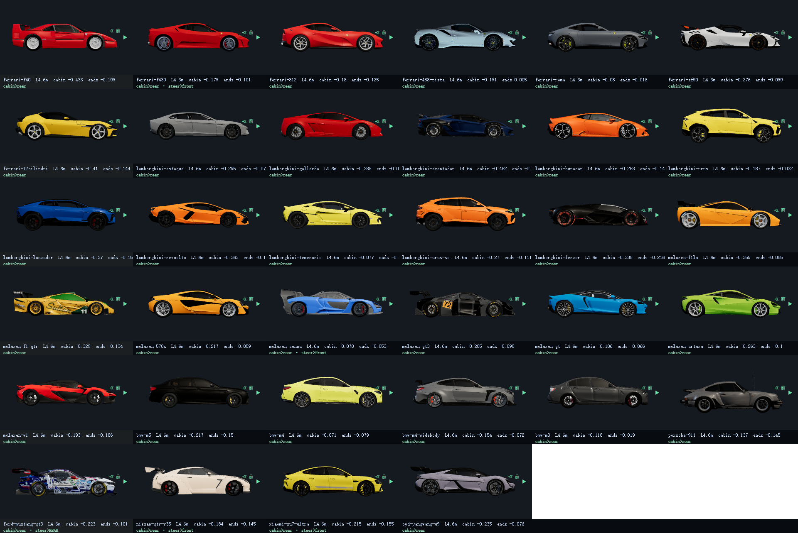

### 2. 语义零件与爆炸

- 构建期合并的车型：`SEMANTIC` 表直接命中作者命名（`door_lf` → 左前车门 / 外饰），无需猜测；
- 其余车型：从 mesh 名 + 材质名推断中文零件名与类别（外饰 / 玻璃 / 灯光 / 空气动力学 / 车轮 / 内饰 / 底盘 / 其他）；
- 爆炸时每个零件按自身包围盒中心计算径向方向，车轮 / 玻璃 / 内饰 / 底盘使用不同径向系数与 Y 层高，最大车漆面板作为核心轻微上移，动画 `easeOutQuint` 完成后自动重新构图。

### 3. 车漆

每块车漆面板替换为独立 `MeshPhysicalMaterial`，保留原材质的法线 / AO 贴图；`preserveLivery` 车型（McLaren F1 LM）额外保留原厂拉花。切换时 `easeInOutCubic` 在 460ms 内插值颜色、金属度、粗糙度、清漆、虹彩、光泽。

车漆材质在构建期识别（`paint` / `carpaint` / `_ext_` / `Base` 等模式，外加人工覆盖），识别失败的烘焙贴图车型（如 BMW M3 G80）会禁用选择器而不是假装生效。

### 4. 菲涅尔壳层

```glsl
float fres = pow(1.0 - abs(dot(normalize(vNormalV), normalize(vViewDir))), uPower);
gl_FragColor = vec4(uColor * fres * uIntensity, fres * uIntensity);
```

`AdditiveBlending + depthWrite:false`，只在轮廓边缘发光；壳层按零件自身中心缩放，避免围绕世界原点放大的偏移。

### 5. 渐进式加载与离线

1. 先加载 `<car>.lod.glb`（约 0.2–2.5 MB）渲染低模占位；
2. 并行流式下载 `<car>.glb`，显示字节进度；
3. 数据写入 Cache Storage；Service Worker 缓存 App Shell 与首款车型；
4. 其余车型首次切换后进入缓存，二次访问离线可用。

### 6. 车库场景

`assets/scenes/garage.glb` 是一个 7.5×3.1×9.1 m 的维修车库（21 个网格 / 16 万三角面），构建期经 WebP 1024 + Draco 压到 **641 KB**，运行期：

- 归一化到 24 m 长，使 5 个视角预设的相机（前后 7.1 m / 侧 8.6 m / 顶 9.3 m / 45° 10.6 m）都落在室内；
- **地面标定**：模型自带一块满尺寸灯箱地坪，扫描时把它的顶面当作真实地面，整间房下移使该面精确落在 y=0——比手写 `garageFloorOffset` 更准，轮胎不再陷入地面（阴影盘贴到 y=0.002）；
- **地面重做**：Lambert 深色水泥（4 m 伸缩缝 + 噪点）+ 加法混合的中心光池 + 工位标线（黄色停车框、转角刻度、转台圆环、`BAY 01`）；
- **陈设**：轮胎堆、轮胎架、红色工具柜、锥筒、油桶、四壁 1 m 高的护墙板与安全黄线、顶部灯带、`CTVIEWER` 霓虹墙招；全部程序化生成，不增加下载体积；
- 原始材质是亮白贴图 + 满亮度发光墙板，运行期重建为「近黑结构 + 冷蓝发光窗板」，并加入 13–44 m 体积雾做纵深；
- 模型自带的轮位工作台原本挡在车尾视线里，运行期沿墙平移 5.2 m；顶部视角会隐藏屋顶并裁剪墙体上沿（局部裁剪平面），从上方仍能看清整车；
- **钢板地面**：`_addGarageFloor()` 在 y=0 的混凝土地面之上再铺一层 60 mm 的花纹钢板（`assets/scenes/garage/plate_*.jpg`，ambientCG CC0，1.1 MB），BoxGeometry 的顶面走 PBR 四张图、四个侧面是深色金属包边，因此看得出一层厚度；`_applyFloorLift()` 把 `modelGroup`、陈设组、光池、工位标线、接触阴影一起抬到板面上，轮胎不再嵌进地板，切回影棚时又整体落回 y=0；
- **玻璃幕墙**：原模型的四面发光墙板换成 44% 不透明的冷调玻璃（`MeshPhysicalMaterial`：clearcoat 1.0、IOR 1.52、envMapIntensity 2.4、`depthWrite: false`），城市天际线仍全幅透出来；`_frameGarageGlass()` 从窗格的顶点坐标里量出横向 / 纵向的缝隙（1.7 m 窗格 + 0.5 m 缝），在每个缝里补一根 140 mm 的铝合金立柱或横梁，玻璃不再是悬空的亮片；
- **天花板彩灯**：`_loadPartyRig()` 在顶棚下挂六根 12 m 霓虹灯管（`toneMapped: false` 保住饱和度）+ 三盏 130 cd 的彩色聚光灯，色相按 `t = 0.05/s` 缓慢流转；同时把 `scene.environment` 换成 Poly Haven `neon_photostudio` 的 PMREM，`_mixSkyLights()` 把日照 / 半球光 / 环境光压到 35%、`_mixGarageLights()` 把车库中性灯压到 38%，彩灯熄灭时逐项还原（实测 on→off→on 全部回到原值）；
- `车库 / 影棚` 一键切换（`?scene=studio`），切换时雾、地面、钢板、窗框、彩灯、裁剪一并复位。

### 7. 城市与天光（Unity 项目资产）

车库外面的世界来自本机 Unity 3D 赛车项目「天天赛车」的
`Assets/CineMachines/Classical_city`，资产已全部复制进本仓库，运行期不再引用原工程：

| 资产 | 用法 |
| --- | --- |
| `city.FBX`（1728 网格 · 104 万顶点 · 34.7 万三角面） | 烘焙成 `assets/scenes/city/city.glb` |
| `Textures/*.tif` 与 `*_light.tif` | 重编码为 JPEG / PNG；`*_light` 作夜间自发光贴图 |
| `day_sky.hdr` / `overcast_sky.hdr` / `night_sky.hdr` | 三档天光，同时作背景与 PMREM 环境 |

烘焙链路（`tools/fbx2glb.html` 在浏览器里跑，`scripts/city_glb.mjs` 在 Node 里收尾）：

```bash
python -m http.server 8031 --bind 127.0.0.1          # 任意静态服务器
# 打开 http://127.0.0.1:8031/tools/fbx2glb.html?export=1
#   → 页面导出 city_raw.glb 并下载；全程没有上传端点，文件只经过浏览器下载
node scripts/city_glb.mjs ~/Downloads/city_raw.glb assets/scenes/city/city.glb
```

1. **定基准面**：FBX 的包围盒底面是模型的「背面」，真正可行走的是那张 161×124 m 的平整网格，位于 y=64.83。以它为零点，车库才不会悬在城市地下的空腔里；
2. **清出广场**：只删除**完全落在**中心 24 m 内的网格（绿化带、灯柱、长椅）。道路平面虽然包含原点，但它是 159 m 长的整块面，必须保留；
3. **修材质**：Phong → MeshStandard。Unity 的 `Glass.mat` 是 2.7% 不透明的纯黑（幕墙后面并没有建内部），直接导出就是纯黑楼；改为明亮的 `building_b` 立面加冷色底。绿化在 Unity 用 `Nature/SpeedTree` 的剪切透明，导出为 `alphaMode: MASK`；
4. **贴图去预乘**：几乎每张 TIF 都带一个不透明材质根本用不到的 alpha 通道，libvips 缩放时会按 alpha 预乘、写 JPEG 时再合成到黑——一张均值 117/255 的立面会被压成 6/255 的纯黑，整座城市因此发暗。改为读原始像素、自己丢掉 alpha 再缩放；
5. **合并 + 压缩**：按材质合并成 10 个网格（1700 → 10 次 draw call），weld 后顶点 104 万 → 50 万，再上 `KHR_mesh_quantization` + `EXT_meshopt_compression`，贴图重编码为 JPEG（绿化保 PNG alpha），**96.7 MB → 13.8 MB**；
6. **性能化（2.17）**：`gltf-transform simplify --ratio 0.12 --error 0.02` 把街区减到 19.2 万面，`scripts/city_resize.mjs` 把 10 张 2048² 贴图降到 512²（sharp 直读 GLB 内嵌图，绕开 libvips 的色彩空间问题），再 meshopt 压缩，**13.8 MB → 4.5 MB**；
7. **布局**：中心街区 620 m 见方、车库在正中；外围 5 份 1.65× 复制环，内缘正好接上中心街区的边缘（`RING_RADIUS = BLOCK_SPAN/2 + BLOCK_SPAN*RING_SCALE/2 - 12`），几何与材质共用，只多出 draw call；相机距中心 110 m 内时整组隐藏（`CityController.setRingsVisible`），因为中心街区会把它们完全挡住。

天光（`js/sky.js`）每档是一张实拍全景：`RGBELoader` → `PMREMGenerator` → 同时喂
`scene.background` 与 `scene.environment`，所以车漆反射的是真实的云层与星空。三张 HDRI 的
**存储亮度差异极大**，`bgIntensity` 分别标定为 1.0 / 9.0 / 3.2，否则「阴天」会黑得像半夜；
夜里再用 `cityDim` 把城市底图压到 40%，Unity 的 `*_light` 窗光贴图才透得出来。

### 8. 交互细节

- 拖动旋转不会误选零件（按下 / 抬起位移超过 5px 视为拖拽）；
- 3D 点选同步零件清单高亮与检视卡，`聚焦零件` / `隔离查看` 随之可用；
- 车型库按品牌分组，显示年代与零件数，当前车型高亮；
- 深链参数在模型就绪后应用，避免慢设备上被加载完成逻辑重置。

### 9. 人物动作重定向

Mixamo 用的是 `mixamorig:LeftUpLeg` 这套 Y-up 骨架，少女前线 2 的角色骨架是 Z-up 的
`Left leg / Left knee / …`，两边的静止姿态、骨骼命名和单位都不同。这里踩过三个坑，
前两个都会把人物弄坏，最终方案是第三个：

**坑一：搬「相对静止姿态的旋转增量」。** 增量默认两边静止姿态一致，但 Mixamo 静止是 T-pose、
游戏骨架静止是 A-pose（手臂已经下垂约 45°）。Idle 里「把手臂放下」的增量叠在已经放下的手臂上，
手就折到身后去了。

**坑二：搬「绝对世界朝向」。** `R_target = C · R_pose · R_rest`。这能让每根骨骼**指向**正确，
但顺带把源骨骼的**卷曲（roll）**也搬了过来。两套骨架的绑定卷曲逐根都不同（髋 0.7°、
大腿 180°、手臂 120°），而蒙皮把卷曲读成绕肢体轴的扭转——于是每根骨头都指着对的方向，
手、肘、腰却是拧着的。逐骨比对脚本 `build/verify_retarget.py` 当时报「0.0° 误差」，
因为它只比对了方向，没比对卷曲，这就是漏判的地方。

**最终方案：只搬摆动量。**

```
swing        = 最短弧（目标骨骼的静止方向 → 动作要求的方向）
R_target     = swing · R_rest_target          # 目标保留自己的绑定卷曲
L_anim       = R_parent_world⁻¹ · R_target
```

- 起点必须是**目标**骨骼的静止方向，不是源骨骼的：这套骨架绑定时手臂已经下垂，
  从源 T-pose 的弧转过来会把手臂甩到身体内侧（试过一次，双手直接插进大腿）；
- 卷曲完全不参与运算，四肢不会被拧；
- 手臂接近竖直向下时整条链额外绕 Z 轴外展 8°（按 `down` 分量平滑淡入），
  让袖口离开髋部的护甲；抬臂动作不受影响；
- 世界朝向是算子不是增量，轴向换算只能在左侧乘一次（`C · R`）；写成共轭 `C · R · C⁻¹`
  会转两遍，人物直接躺平；
- 髋部竖直位移以**骨架静止髋高**为零点，不是第 0 帧：Mixamo 动作常常起手就微屈膝，
  用第 0 帧当基准会让整段悬空 10–20 cm；
- 每个角色再按自己的髋高重设髋部轨道（`adaptHipsClip`），否则共用动作库时高个角色
  （黛烟 1.045 m）会被压到参考角色的髋高、脚陷进地面 15–22 cm；
- 髋部水平位移扣掉整段线性漂移（Mixamo 走 / 跑带根运动，位移交给控制器）；
- 最后用 `tools/ground_bake.html` 采样每个人物每段动作的**蒙皮**包围盒（骨架不算装甲厚度），
  写出 `assets/characters/ground.json`：躺姿 / 跪姿的帧抬到地面上，腾空帧不动。
  采样要排除头发 / 毛领 / 流苏（长马尾躺下会铺到地面以下，抬身体反而让人悬空），
  并且必须 `LoopOnce + clampWhenFinished`（默认循环下 `setTime(duration)` 会绕回第 0 帧，
  Stand Up 结尾站着、开头躺着，会把整段抬半米）。

**顺带查清的另一个坑**：15 段动作 FBX 每段都自带一整套 Mixamo 人物（24,746 顶点 / 65 骨），
但 Blender 的 FBX 导入器给 armature 对象加了 +90° X 和 0.01 缩放，导出的 GLB 里
Hips 平移落在 Z 轴、骨骼旋转带 180° 补偿——这套动作 GLB 挂到任何 Mixamo 原生人物上都会躺平。
`build/export_mixamo_clips.py` 在导出前先 `transform_apply` 把对象变换烘进骨骼，
产物才和 Mixamo 人物 GLB 同构（根节点单位旋转、Hips 在 +103 单位）。

实测（10 人物 × 15 动作，每段 13 个采样点）：所有动作最低顶点落在 −5 mm … +1 mm。
探索实测（2.16）：步行 1.70 m/s 切 `Walking`，按住 `Shift` 疾跑实测 9.2–9.8 m/s（参数 8.8 m/s，
样本受 17 fps 帧间隔影响）切 `Running`，松手回 `Idle`，`Space` 起跳离地 0.92–0.95 m
（1.5 × 原 0.63 m）后落回 y=0。人物物理改成 1/120 s 固定子步、帧钳放宽到 1/12 s 后，
低帧率不会再让跑速或跳跃高度缩水（改之前 17 fps 下跳跃只有 0.81 m、2 s 位移少 15%）。

### 10. 玩法层（2.19）

- **试驾物理**：`js/drive.js` 把速度拆成前向 / 侧向两个分量，前向由油门 / 刹车 / 阻力驱动，侧向按
  `exp(-grip·dt)` 衰减；转向用运动学自行车模型 `yawRate = v / wheelbase · tan(steer)`，转向角随车速
  从 36° 收到 6°，手刹把侧向抓地降到 0.7 并给 1.5× 横摆，于是高速会甩尾而不是像轨道车。
  1/120 s 固定子步保证低帧率下手感不变。
- **碰撞**：车头 / 车尾 / 四角 / 两侧中点共 8 个采样点，复用城市 1 m 占位网格、车库 −X / −Z 实墙、
  道具占地盒和举升机立柱；轴向滑动让撞墙后沿着墙走，正面撞击则 `vel *= -0.12` 回弹。
- **原地起步**：进入试驾不再播放自动驶出过场，车辆留在展位原位、只在地面把车头转向车库开口
  （+Z 一侧）；油门、刹车、转向全部交给玩家，停稳后才能按 `E` 下车，下车时回到原来的展位姿态。
  2.18 的 1.9 s 贝塞尔过场已删除，避免「点一下试驾车自己先跑几米」。
- **举升机**：程序化两柱（立柱 + 滑台 + 四条可摆臂 + 安全黄），降下时整组隐藏并把立柱碰撞盒从
  道具列表里移除，所以展车视角不会被一根黑柱子挡住；升起时 0.85 m/s 到 1.5 m，车与爆炸零件一起上升。
- **拍照**：自由相机复用场景与当前车漆 / 人物；滤镜是 CSS filter 字符串，画布实时预览、PNG 用
  2D canvas 的 `ctx.filter` 烘焙、WebM 把渲染帧画进同一个 2D canvas 再 `captureStream`，三处观感一致。
  WebGL 画布不保留绘制缓冲，所以截图 / 录制必须在 `renderer.render()` 之后同一次任务里取帧。
- **回形布局**：左侧车漆、右侧零件、顶部车型条与底部一条横向玻璃条围住 3D 画面；底栏按
  「拆解 / 视角 + 天光 / 场景与工具」分段，**试驾 / 拍照 / 举升是右下角三张小图标卡**（悬停有说明），
  底栏 `flex-wrap: nowrap` 不换行；1600 px 以下次要按钮只留图标，把纵向空间还给画面。
- **已移除**：车身开合（门板铰链 / 开合条 / `O`、`C` 快捷键）与靠车 / 坐引擎盖 / 抱胸三种摆拍姿势。

### 性能（2.17）

同一台机器（Iris Xe 集显，1701×1007，DPR 1，45° 主视角）实测：

| 指标 | 2.16 | 2.17 | 变化 |
| --- | ---: | ---: | ---: |
| draw call | 534 | **200** | −63 % |
| 三角面 / 帧 | 2,707,985 | **436,628** | −84 % |
| 帧率 | 17–22 FPS | **45–52 FPS** | ≈2.4× |
| 城市下载 | 13.8 MB | **4.5 MB** | −67 % |
| 城市贴图 | 10 × 2048²（约 212 MB 显存） | **10 × 512²（约 13 MB）** | −94 % |
| 道具 | 48.4 万面 / 150 网格 | **20.6 万面 / 91 网格** | −57 % / −39 % |

五处改动按收益排序：①远景环在中心附近隐藏（−169 万面）；②车模 9 个窗户与发电机玻璃的
`transmission=1` 会触发 three 的整帧透射通道（多画一遍全场景），改成普通透明后单帧提交
14.7 → 1.3 ms；③城市 simplify + 512² 贴图；④道具 simplify 40 % + 按材质合批、窗框 20 → 1；
⑤动态分辨率在 0.55–1.0 之间按实测帧率调节（0.76 时 45–48 FPS，0.85 时 46 FPS，1.0 时 38 FPS）。
探索模式：出生点附近（远景环隐藏）58 FPS，走到 200 m（远景环显示）53 FPS。

## 八、验收

```bash
npm test                 # 静态结构与资源验收（400 项）
npm run test:browser     # Playwright 多车型冒烟测试
```

详细数据见 [docs/验收报告.md](docs/验收报告.md)，实施过程见 [docs/实施计划.md](docs/实施计划.md)，后续路线见 [docs/下一步升级建议.md](docs/下一步升级建议.md)，本文「七、技术要点」即为技术方案。

## License

代码 MIT；Three.js 遵循 MIT（`vendor/three/LICENSE`）。25 款车型模型来自 GitHub 仓库 [`supercar3d/supercar_3D_asssets`](https://github.com/supercar3d/supercar_3D_asssets)，原始模型来自 Sketchfab，按各自 CC 许可使用（24 款 CC BY 4.0，Porsche 911 为 CC BY-SA 4.0）。另外 9 款来自 5 个第三方 GitHub 仓库（TN1608 / Wretched Lab / jiaxiantao / sebastianvasquez / Xerox1010555），**均未声明许可**，仅适合个人本地学习，不得对外分发。10 位人物与 15 段动作来自用户本机的 Unity《天天赛车》工程（少女前线 2 角色 + Mixamo 动作），同样**未声明许可**，仅限个人本地使用。完整署名见 [CREDITS.md](CREDITS.md)。
